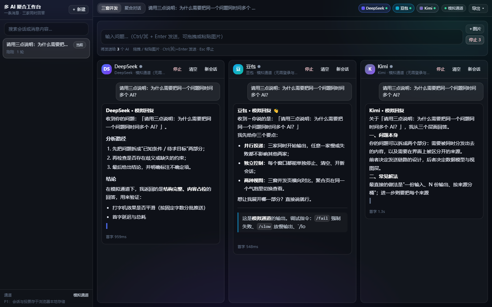
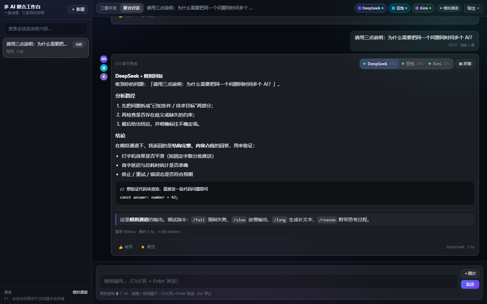
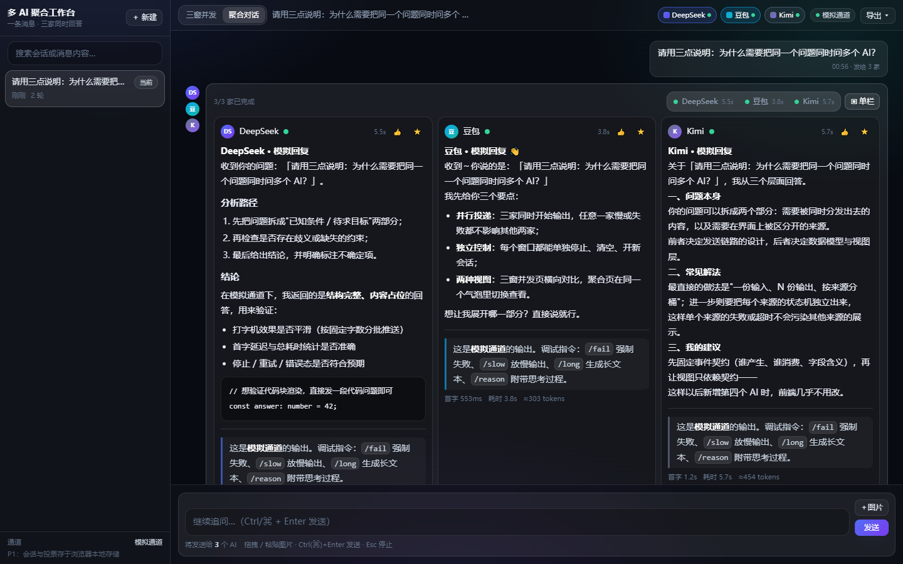
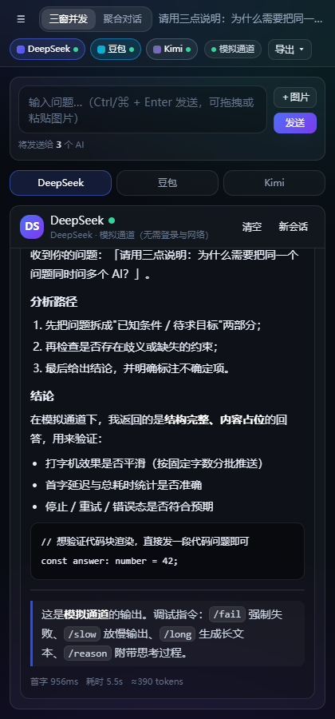

# 多 AI 聚合工作台

把**一条消息（文字 + 图片）同时分发给 DeepSeek / 豆包 / Kimi**，并提供两种查看方式：
三窗并发横向对比、聚合对话（同一气泡里切换/并排）。

设计文档见 [方案设计.md](方案设计.md)（路线选型、数据流图、接口契约、限制与降级）。

| 三窗并发（流式输出中） | 聚合对话（气泡内切换） | 并排对比 |
| --- | --- | --- |
|  |  |  |

移动端（<768px 自动变 Tab 切换）：

---

## 一、现在的完成度（请先读这一节）

| 阶段 | 内容 | 状态 |
| --- | --- | --- |
| **P0** | 工程骨架：monorepo + Fastify + Vite + TS + Tailwind + 健康检查 | ✅ 完成 |
| **P1** | **Mock 通道 + 两个页面全部交互**（离线可验证，不装浏览器、不登录、不联网） | ✅ 完成 |
| P2 | 服务端持久化（node:sqlite + 图片落盘 + 会话 CRUD + 断线重放） | ⏳ 待做 |
| P3 | **路线 A：Playwright 驱动三家 C 端网页版**（登录态、文本/图片注入、流式抓取） | ⏳ 待做 |
| P4 | 路线 B：三家官方 API（与网页通道同层可切换，hybrid 自动降级） | ⏳ 待做 |
| P5 | 观测窗（实时画面 + 输入转发，用于处理偶发验证码） | ⏳ 待做 |
| P6 | docker-compose、jsdom 回归测试、微信小程序薄壳 | ⏳ 待做 |

**现在跑起来看到的是"模拟通道"**：回答是本地造的假数据，但**每一条前后端链路都是真的**——
真的 HTTP 投递、真的 WebSocket 流式推送、真的状态机（pending → streaming → done/error）、
真的停止/重试、真的响应式布局。所以 P3 只需要换掉"怎么把消息发出去、怎么把回答抓回来"，
前端与协议一行都不用改。

模拟通道的假回答里内置了调试指令，方便你把每种状态都点一遍（见下文"调试指令"）。

---

## 二、快速开始

```bash
# 1. 安装依赖（Node 20+，本机实测 Node 24.21）
npm install

# 2. 启动（后端 8787 + 前端 5173 一起拉起，Ctrl+C 全部停止）
npm run dev
```

打开 **http://127.0.0.1:5173** 即可。

生产模式（前端构建产物由后端托管，只占一个端口）：

```bash
npm run build     # 构建前端到 packages/web/dist
npm start         # 打开 http://127.0.0.1:8787
```

可选的 `.env`（从 `.env.example` 复制）：所有配置项都有合理默认值，**不配也能跑**。

---

## 三、怎么用

### 三窗并发页

- **顶部输入区**：打字，或把图片**拖进来**／在输入框里 **Ctrl(⌘)+V 粘贴**／点「＋图片」选择。
  图片会先在浏览器里压到最长边 1600px、JPEG 质量 0.85 再发送，缩略图可单张删除。
- **发送**（按钮或 `Ctrl/⌘ + Enter`）：同一条消息**同时**投递给勾选的所有 AI。
  顶部 `☑DeepSeek ☑豆包 ☑Kimi` 是全局开关，**取消勾选的不会收到消息**。
- 每个窗口独立：**停止**（只停自己）／**清空**（只清本窗口显示，不动站点上下文）／
  **新会话**（让该站点开新对话并清空本窗口）。
- 三窗**滚动互不同步**；每个窗口自己判断"用户是否贴在底部"，不会互相抢滚动。
- 底部显示每家的**首字延迟 / 总耗时 / token 估算**（token 是估算值，网页版拿不到真实 usage）。

### 聚合对话页

- 用户消息在右，三家的回复**聚合在左侧同一个气泡**里。
- 气泡**右上角**是切换控件：`DeepSeek 5.5s · 豆包 3.8s · Kimi 5.7s`，
  每个 Tab 带状态圆点 —— **灰=加载中，绿=已完成，红=失败**；切换时内容淡入替换并**保留滚动位置**。
- **▥ 并排**：把这一轮变成三列对比（每列独立滚动、各自可投票）。
- **👍 有用 / ⭐ 最佳**：最佳答案在同一轮里互斥；投票与会话一起存在浏览器本地存储。
- **导出 ▾**：Markdown（按轮次分节，含统计与投票）或 JSON（完整结构，含图片 dataURL）。
- 左侧会话栏：新建 / 重命名 / 删除 / 搜索（标题与消息内容都能搜到）。

### 快捷键

| 快捷键 | 作用 |
| --- | --- |
| `Ctrl / ⌘ + Enter` | 发送 |
| `Esc` | 停止当前会话里所有正在生成的回复 |

### 模拟通道调试指令

直接在输入框里写这些词（可组合）：

| 指令 | 效果 |
| --- | --- |
| `/fail` | 这一轮强制失败（三家分别返回 network / timeout / risk 三种错误码，可把每种错误 UI 都点一遍） |
| `/slow` | 放慢输出（用来验证"停止生成"与流式滚动） |
| `/long` | 生成长文本（用来验证长回答与并排布局） |
| `/reason` | 附带"思考过程"（验证折叠展示与排除逻辑） |

---

## 四、目录结构

```
AI聚合工作台1012/
├── 方案设计.md · README.md · .env.example
├── package.json                    # npm workspaces（shared / server / web）
├── packages/
│   ├── shared/src/                 # ★ 前后端唯一真源：类型、常量、WS 事件契约、纯函数
│   │   ├── types.ts                #   Provider / Message / Reply / Session / Vote
│   │   ├── events.ts               #   ServerEvent / ClientEvent
│   │   ├── constants.ts            #   三家元信息（品牌色、地址、默认开关）
│   │   └── utils.ts                #   token 估算、耗时格式化、id 生成
│   ├── server/src/
│   │   ├── index.ts                # Fastify 装配、WS 路由、静态托管、空 body 兼容
│   │   ├── config.ts               # 环境变量集中解析（含 .env 加载）
│   │   ├── adapters/
│   │   │   ├── types.ts            # ★ ChatAdapter 接口（新增 AI 只改这里 + registry）
│   │   │   ├── mock.ts             # ★ 离线假回复通道
│   │   │   ├── registry.ts         #   按 ADAPTER_MODE 装配（P3/P4 在这里插真实通道）
│   │   │   └── errors.ts           #   带错误分类的异常
│   │   ├── core/
│   │   │   ├── bus.ts              # ★ ProviderBus：跨站并行、同一站点串行
│   │   │   └── orchestrator.ts     # ★ 一次发送 → N 条回复的状态机与事件编排
│   │   ├── http/routes.ts          # /api/send /api/replies/:id/stop|retry /api/health …
│   │   └── ws/hub.ts               # 订阅、广播、seq 序号
│   └── web/src/
│       ├── pages/ConcurrentPage.tsx    # 页面 1：顶部输入 + 三列
│       ├── pages/AggregatePage.tsx     # 页面 2：单列 IM + 气泡内切换
│       ├── components/                 # Composer / ChatColumn / ProviderTabs / ParallelCompare …
│       ├── store/useStore.ts           # ★ 会话状态 + localStorage 持久化
│       ├── ws/client.ts                # 自动重连 + 会话订阅
│       ├── api/client.ts · lib/{image,markdown,color,download}.ts
│       └── styles/index.css            # 设计令牌：深色玻璃拟态、圆角 12px、打字机光标…
├── scripts/
│   ├── dev.mjs                     # 并拉起前后端（用 stdio:inherit，不引 concurrently）
│   ├── smoke.mjs                   # ★ 后端端到端烟测（31 项断言，不需要浏览器）
│   ├── shot.mjs                    # 用本机 Edge 截图 + 执行页面步骤（E2E 引擎）
│   └── verify.mjs                  # ★ 一键自检：类型检查→构建→烟测→截图→布局断言
└── docs/screenshots/
```

---

## 五、架构要点（为什么这么设计）

1. **`ChatAdapter` 是唯一的扩展点。** 网页通道（Playwright）与官方 API 通道实现同一个接口，
   前端完全感知不到差异。新增第四个 AI：改 `shared/types.ts` 的 `Provider`、
   `shared/constants.ts` 的 `PROVIDER_META`、写一个 Adapter、在 `adapters/registry.ts` 注册。
2. **同一站点必须串行（`ProviderBus`）**：这是正确性问题——网页通道靠"发送前后的页面快照差分"
   抓回答，同一站点并发两条消息会让差分串台。跨站点则必须并行，那是产品核心体验。
3. **`reply.delta` 推的是累计全文**，不是增量片段：前端直接覆盖渲染，
   天然免疫丢帧与乱序导致的文本错乱。
4. **`clientMsgId` 关联**：WS 事件可能比 `POST /api/send` 的响应先到，
   所以前端先落本地轮次，靠 `clientMsgId + provider` 关联事件，拿到响应后再回填 `replyId`。
5. **前端是会话状态的持有者（P1）**：后端无状态，只负责执行；P2 会把权威存储搬到 SQLite，
   前端退化成缓存镜像（届时接口契约不变）。
6. **图片持久化是已知取舍**：dataURL 进 localStorage 会几秒撑爆 5MB 配额，
   所以落盘时只保留元信息，刷新后显示"历史图片未保留"占位。
   P2 图片改由服务端落盘返回 URL 后即可真正持久化。

---

## 六、环境变量

| 变量 | 默认 | 说明 |
| --- | --- | --- |
| `PORT` | `8787` | 后端端口 |
| `HOST` | `127.0.0.1` | 默认只监听本机；改成 `0.0.0.0` 才能用手机访问（注意安全） |
| `LOG_LEVEL` | `info` | `debug` 时会打印每个 delta 的完成情况 |
| `ADAPTER_MODE` | `mock` | `mock` / `web`（路线 A）/ `api`（路线 B）/ `hybrid`。**后三者尚未实现，会明确告警并回退 mock** |
| `DATA_ROOT` | `./data` | SQLite 与上传图片（P2 使用） |
| `PROFILE_ROOT` | `D:/MUMUcode/aiworkbench-data/profiles` | 浏览器 `user-data-dir`（P3 使用）。**必须是纯英文短路径**，见下文"中文路径" |
| `MOCK_FIRST_TOKEN_*` | `900/500/1200` | 三家的模拟首字延迟（毫秒），刻意做出差异 |
| `MOCK_CHUNK_MS` / `MOCK_CHUNK_SIZE` | `35` / `4` | 流式分片速度与粒度 |
| `MOCK_FAIL_RATE` | `0` | 固定失败率（0~1），用来演示错误态 |
| `MOCK_SHOW_REASONING` | `false` | 是否输出"思考过程" |
| `DEEPSEEK_API_KEY` / `DOUBAO_API_KEY` / `KIMI_API_KEY` | 空 | P4 路线 B 使用 |

---

## 七、自检与测试

```bash
npm run typecheck          # 前后端类型检查（tsc --noEmit）
node scripts/smoke.mjs     # 后端端到端烟测（需要后端已在 8787 运行）
node scripts/devcheck.mjs  # 开发模式自检：验证 npm run dev 本身可用 + Vite 的 /api 与 /ws 代理
node scripts/verify.mjs    # 一键全流程自检（自动构建并启动后端，跑完自动关闭）
```

`scripts/verify.mjs` 会依次做：类型检查 → 构建前端 → 起后端 → 31 项后端断言 →
用本机 Edge 截图 8 个场景 → 断言"1440 宽三列全显示 / 420 宽只显示一窗"，
产物在 `.tmp/shots/`。
`scripts/devcheck.mjs` 走的是**另一条链路**（Vite 5173 + 代理），
它会真的在页面上发一条消息，确认 `/api` 与 `/ws` 代理都通、流式内容确实到了页面、且没有 JS 报错。

**最近一次全绿结果**：后端 31/31，页面场景 9/9，响应式断言 2/2，开发模式 6/6。

> 两个自检脚本都会在启动前**检查端口是否空闲**，并在结束时**同步回收整棵进程树**。
> 这不是洁癖：实测遇到过"上一轮残留的后端占着 8787，新后端 EADDRINUSE 死掉，
> 而 Vite 代理连到了那个陈旧实例"，表现是"页面一切正常、就是消息发不出去"，极难定位。


---

## 八、三家登录态怎么保存与刷新（P3，先写清设计）

> 这一节描述的是**路线 A（Playwright 驱动 C 端网页版）**的做法，随 P3 落地。
> 现在 `ADAPTER_MODE=web` 会明确告警并回退到模拟通道，不会假装可用。

- **保存**：每个站点一个独立的持久化上下文
  `chromium.launchPersistentContext(PROFILE_ROOT/<provider>)`。
  为什么用持久化目录而不是 `storageState`：三家的登录态不只在 Cookie 里，
  还有 localStorage / IndexedDB，`storageState` 存不全，重启后容易掉登录。
- **首次登录**：`npm run login`（P3 提供）会以**可见窗口**依次打开三家站点，
  你手动扫码/输验证码，登录完成后窗口关闭，登录态就落在 `PROFILE_ROOT` 里了。
- **日常运行**：浏览器以 headful + **离屏**方式常驻（`--window-position=-32000,-32000`），
  既不会被反自动化检测识别成 headless，也不干扰你干活。
  注意页面**不能压小**：实测把窗口压到 176px 高，站点会切折叠布局、DeepSeek 的发送按钮直接消失。
- **登录态失效**：每次发送前做一次轻量探测（输入框是否可见 + 是否出现登录框/二维码）。
  失效时前端出现红色状态点，点顶部的通道状态芯片可手动刷新，
  重跑 `npm run login` 即可恢复。
- **遇到验证码/风控**：**不自动绕过**。命中风控词或验证码选择器时，
  该站状态置为"需要人工处理"，前端提示，并提供"把窗口召回到屏幕"
  （通过 CDP `Browser.setWindowBounds`），你处理完继续用。
- **换机器/清空**：直接删掉 `PROFILE_ROOT/<provider>` 目录即可（里面是 cookie 与 session token，
  **不要提交到仓库**）。

---

## 九、常见报错处理

| 现象 | 原因与处理 |
| --- | --- |
| `npm.ps1 cannot be loaded` / "禁止运行脚本" | PowerShell 执行策略。改用 `cmd`，或把命令写成 `npm.cmd ...` |
| `ECONNREFUSED 127.0.0.1:10808` | 环境变量 `HTTP_PROXY` 指向了一个**没在运行**的代理。命令级清空：`$env:HTTP_PROXY=""; $env:HTTPS_PROXY=""` |
| `npm install` 报 `EPERM ... _cacache` | 当前用户级 npm 缓存不可写。把缓存指到工作区内：`npm install --cache "<仓库>/.npm-cache"` |
| `npm install` 报 `EPERM ... spawn` | 生命周期脚本用管道捕获输出被拒（受限沙箱常见）。加 `--ignore-scripts`（本项目没有必须跑 install 脚本的依赖） |
| `vite` / `tsx` 报 `Error: spawn EPERM`（esbuild） | esbuild 必须用管道启动自身服务进程，**受限沙箱里做不到**。在你自己的终端里运行，或对该命令放宽沙箱权限 |
| 页面能打开但顶部显示"WebSocket 已断开" | 后端没起来（或端口被占）。看 `npm run dev` 的日志，或单独 `npm run dev:server` |
| `EADDRINUSE :8787 / :5173` | 端口被占。先结束占用者：`Get-NetTCPConnection -LocalPort 8787 \| ForEach-Object { taskkill /PID $_.OwningProcess /T /F }`；或改 `.env` 的 `PORT` 与 `packages/web/vite.config.ts` 里的 dev 端口/代理目标 |
| 页面一切正常，但**消息发出去没有任何回复**（三列一直"正在思考"） | 十有八九是 8787 上跑着一个**陈旧的后端实例**（上一轮没清干净），Vite 代理连到了它。用上一条命令清掉占用者再 `npm run dev`；`npm run dev` 自己也会回收进程树，`node scripts/verify.mjs` / `devcheck.mjs` 会在启动前检查端口 |
| 刷新页面后正在生成的回复变成"已中断" | **符合预期**：P1 的流不会跨页面刷新续传（P2 服务端持久化后会做 seq 校验与快照补发） |
| 历史消息里的图片显示"历史图片未保留" | **符合预期**：P1 只把图片留在内存，落盘会剥掉 dataURL（见上文取舍） |
| 三家回答的长度统计/耗时与官方不一致 | token 是**估算值**（CJK 约 1.6 tok/字），网页版拿不到真实 usage；耗时是真实的 |
| 站点改版后抓不到回答（P3 起） | 跑 `GET /api/diag/selectors` 看哪个选择器没命中，然后只改 `site-config` 一个文件里的候选数组 |

### 本机已知环境情况（实测）

- Node **24.21.0**；`npm` 走 `registry.npmmirror.com`；`node:sqlite` 可用（P2 将用它，免原生编译）。
- 本机**没有**下载 Playwright 自带 Chromium，但有 **Edge 155**：截图脚本用
  `playwright-core` + `channel: 'msedge'`，**零下载**。要 Chromium 时：
  `PLAYWRIGHT_DOWNLOAD_HOST=https://cdn.npmmirror.com/binaries/playwright npx playwright install chromium`。
- **中文路径**：旧项目实测过"Chromium/Electron 无法从含中文的目录加载"，
  所以浏览器 `user-data-dir` 默认放在工作区外的纯英文路径（`PROFILE_ROOT`）。
  Node 读写中文路径没有问题，因此本项目源码目录保持中文命名。
- GitHub 推送经代理 `127.0.0.1:10808`（v2rayN）；代理没启动时 `git push` 会失败，先本地 commit/tag 即可。

---

## 十、平台限制与降级（必须显式说明的部分）

| 限制 | 现实情况 | 处理方式 |
| --- | --- | --- |
| 滑块 / 短信 / 扫码人机验证 | **无法自动绕过，也不打算绕** | 命中风控词或验证码选择器 → 状态置"需要人工处理" + 一键把窗口召回到屏幕，人工完成后继续 |
| 登录态会过期 | 站点主动踢下线 | 发送前轻量探测；失效给红点 + 提示重跑 `npm run login` |
| 选择器随站点改版失效 | 必然发生 | 每个字段都是**多候选数组**，命中即用；`/api/diag/selectors` 给命中报告；只需改一个配置文件 |
| 编辑器内部模型不同步 | Lexical/ProseMirror 会"看着有字、其实没字"（发送键仍禁用） | 三级注入降级（CDP 分块 `insertText` → 原生 setter + 事件 → `execCommand`），每次注入后**读回校验** |
| 长文本被内核静默截断 | 豆包实测会截断 | 分块 20 字插入 |
| 回答结束判定 | 不能靠"停止生成按钮消失"（三家都会匹配到常驻元素，永远卡住） | 用**文本稳定 4.5 秒**判定，超时兜底 |
| 思考过程污染答案 | 三家都把推理过程渲染在页面上 | 抓取时按类名与文本特征排除（DeepSeek `ds-think-content`、Kimi `thinking-container`、豆包"已思考"） |
| 反自动化检测 | 站点识别 headless / 自动化特征 | 用真实 Edge/Chromium + headful + 离屏 + 去掉标记的 UA；不用 headless 跑日常 |
| 自动化频率限制 | 高频发送可能被限流 | 同一站点串行 + 最小间隔 300ms + 失败退避重试 |
| **账号风险** | 三家服务条款通常禁止自动化访问，可能导致限流或封号 | **建议用专用小号**、仅本机个人对比使用、**禁止批量刷量**。风险自负 |
| 微信小程序 | 生产环境无法直连 `ws://localhost`，需**备案域名 + wss + 服务器域名白名单**（开发期可勾"不校验合法域名"） | 列为 P6 之后的可选薄壳，复用同一套 HTTP/WS 契约 |
| 3×Chromium 内存 | 约 1.5–3GB | 单机可接受；Docker 里需要 `shm_size: 2gb` |

---

## 十一、合规提示

本项目是**本机个人对比工具**：帮你把同一个问题同时问几家 AI，然后横向看差异。
请遵守三家（DeepSeek / 豆包 / Kimi）各自的服务条款，不要用于批量刷量、爬取或任何违规用途。
